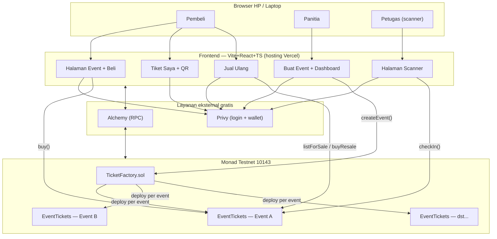
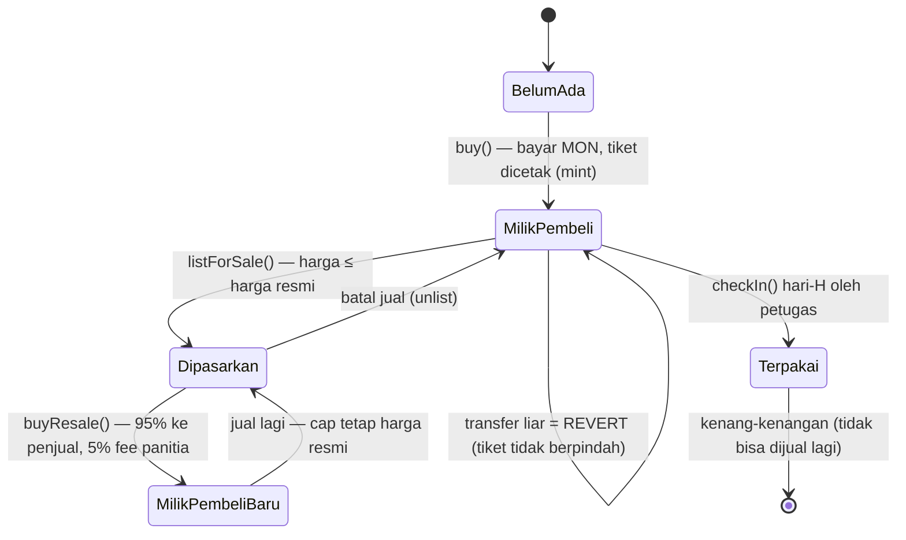
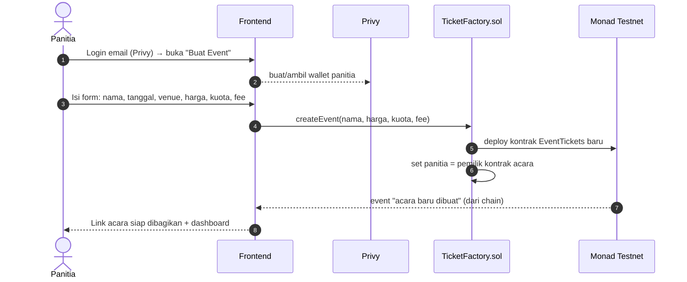
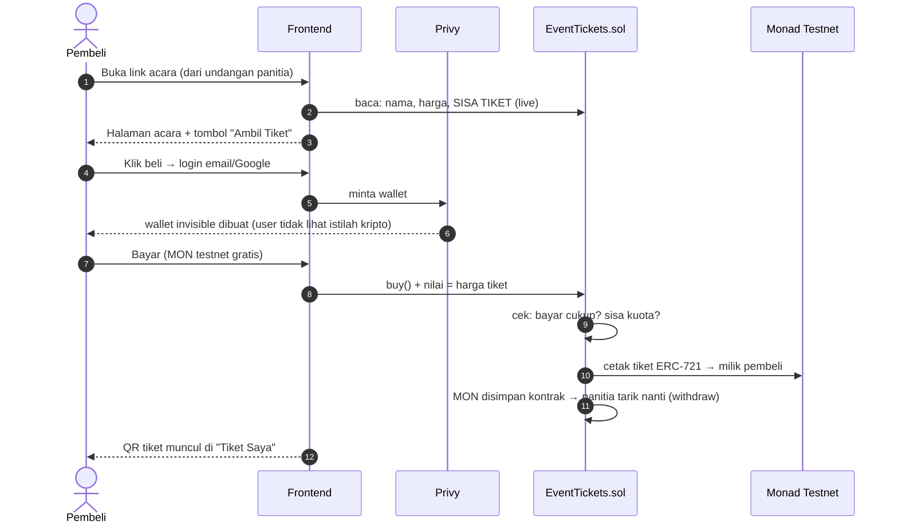
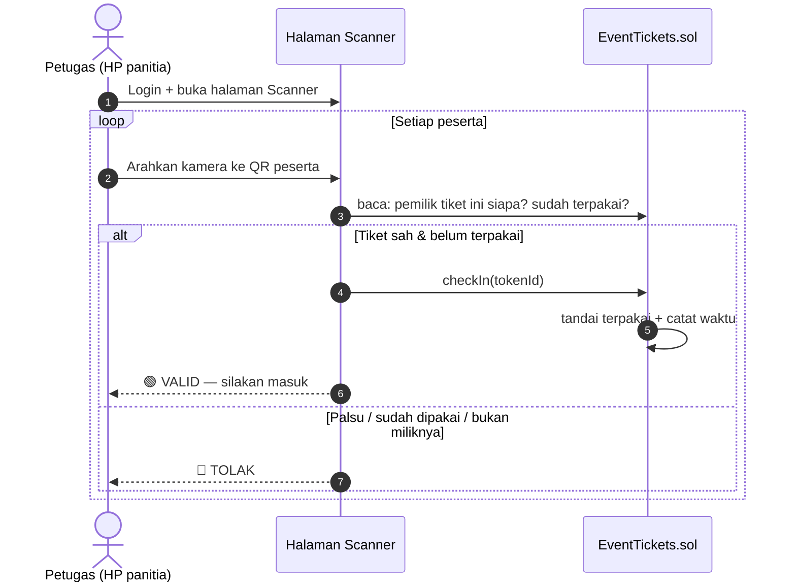
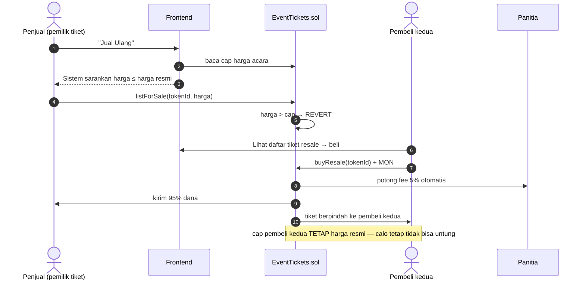
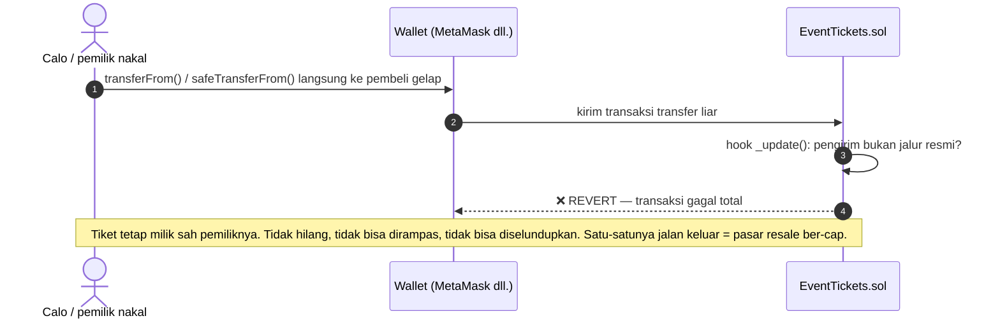

# 🎟️ NEPEL — Blueprint Lengkap Proyek

> **Tiket yang nempel di orang** — tiket acara komunitas anti-hangus & anti-calo, on-chain di Monad.
> **Hackathon:** Monad Metropolis · **Track 02 — Consumer Products & Payments** ($30.000 / 3 tim terbaik)
> **Build window:** 1 Sep – 13 Okt 2026 · **Target submit:** 12 Okt (buffer 1 hari) · Winners: 3 Nov
> **Sumber resmi:** <https://monad.xyz/developers/hackathons/metropolis>

---

## Daftar Isi

1. [Identitas & Ide](#1-identitas--ide)
2. [Arsitektur Sederhana](#2-arsitektur-sederhana)
3. [User Workflow](#3-user-workflow)
4. [Gambaran 30 Detik: Sistem Ini Apa?](#4-gambaran-30-detik-sistem-ini-apa)
5. [Tech Stack Lengkap (semua Rp0)](#5-tech-stack-lengkap-semua-rp0)
6. [Arsitektur Keseluruhan](#6-arsitektur-keseluruhan)
7. [Riwayat Hidup Sebuah Tiket (inti logika anti-calo)](#7-riwayat-hidup-sebuah-tiket-inti-logika-anti-calo)
8. [Alur Sistem Kerja — Sequence Diagrams](#8-alur-sistem-kerja--sequence-diagrams)
9. [Alur Kerja Dev: 4 Fase (10 Sep → 12 Okt)](#9-alur-kerja-dev-4-fase-10-sep--12-okt)
10. [Directory Tree Lengkap (F0 → Produksi/Submit)](#10-directory-tree-lengkap-f0--produksisubmit)
11. [Sponsor & Bounty Metropolis](#11-sponsor--bounty-metropolis)
12. [Syarat Submit Resmi](#12-syarat-submit-resmi)
13. [Kamus Mini](#13-kamus-mini)

---

## 1. Identitas & Ide

### Track 02 — Consumer Products & Payments

**Ide 2: "Tiket yang Nempel di Orang" — Tiket acara komunitas anti-hangus**

**Konsep:** Tiket digital yang kepemilikannya dicatat on-chain, jadi kalau acara pindah platform atau kamu pindah komunitas, tiketmu tetap hidup. Bisa atur aturan resale otomatis (misal: harga jual maksimal = harga beli, biar calo mati) — ini ide resmi #2 track-nya.

- **MVP-nya:** kontrak NFT sederhana (tiket) + halaman pembelian/claim + QR check-in
- **Sektor nyata Indonesia:** acara kampus, workshop, kajian, community meetup — semua penderita "tiket hangus"
- **Kesulitan solo:** ⭐️⭐️⭐️/5 (NFT-nya gampang, tapi sistem check-in menambah kerja)
- **Nilai jual ke juri:** aturan resale terprogram = fitur yang tidak bisa ditawari Tiket/Loket — onchain-native

---

## 2. Arsitektur Sederhana

```
TicketFactory.sol  ← panitia buat event dari UI (deploy 1 kontrak per event)
    └─ EventTickets.sol (ERC-721 di Monad testnet 10143)
         ├─ buy()        : bayar → tiket + QR
         ├─ resale()     : harga DIKUNCI ≤ harga beli + fee 5% panitia (on-chain)
         ├─ _update()    : transfer di luar jalur resmi = REVERT ← inti anti-calo
         └─ checkIn()    : scan 1x per tiket, tercatat di chain

App React (tanpa backend, tanpa DB — semua dari chain, hemat biaya)
```

---

## 3. User Workflow

### 👤 Pembeli

> Buka link event → lihat sisa tiket live → "Ambil Tiket" → login email (wallet otomatis, tanpa kata "blockchain" di UI) → bayar → QR di "Tiket Saya" → hari-H tunjuk QR → petugas scan → masuk. Tidak bisa datang? Jual ulang dengan harga otomatis dibatasi ≤ harga beli — calo tidak bisa untung.

### 🎪 Panitia

> Form "Buat Event" → bagikan link → dashboard penjualan real-time → hari-H buka halaman Scanner di HP → hijau/merah → dana fee resale masuk otomatis.

---

## 4. Gambaran 30 Detik: Sistem Ini Apa?

NEPEL = aplikasi web penjualan tiket acara, tapi **buku catatan resminya adalah blockchain Monad**, bukan server. Tiga konsekuensi penting:

1. **Tidak ada backend & tidak ada database.** Server itu tempat kepercayaan disimpan (dan bisa curang/tutup). Di sini, semua catatan — siapa punya tiket, tiket mana yang sudah dipakai, berapa harga jual maksimal — tersimpan di kontrak pintar. Frontend cuma "pembaca & penulis" ke chain.
2. **Tiket = NFT (ERC-721).** Mirip sertifikat tanah digital: ada nomor unik, ada pemilik sah, dan perpindahan hanya sah kalau lewat prosedur resmi.
3. **Aturan anti-calo dipatri di kontrak, bukan di UI.** UI bisa di-bypass orang; kontrak tidak bisa "dipaksa" siapa pun. Ini inti pitch kita.

---

## 5. Tech Stack Lengkap (semua Rp0)

| Lapisan | Alat | Tugasnya | Biaya |
|---|---|---|---|
| Blockchain | **Monad Testnet** (chain 10143) | "Server" tempat semua data & dana | Gratis (faucet MON) |
| Kontrak | **Solidity** + **OpenZeppelin** (ERC-721) | Bahasa kontrak + komponen teruji keamanannya | Gratis |
| Toolkit kontrak | **Foundry** (`forge`, `cast`, `anvil`) | Tulis test, deploy, debug kontrak | Gratis |
| Login & wallet | **Privy** | User login pakai email/Google → wallet dibuat otomatis "di balik layar" | Gratis ≤ ~1.000 user/bln |
| Frontend | **Vite + React + TypeScript** | Aplikasi web pembeli & panitia | Gratis |
| Penghubung chain | **wagmi + viem** | Library React ↔ kontrak (baca data, kirim transaksi) | Gratis |
| QR pembeli | **qrcode.react** | Gambar QR dari data tiket | Gratis |
| QR scanner | **html5-qrcode** | Kamera HP panitia membaca QR | Gratis |
| RPC | **Alchemy** (sponsor) | "Jalan tol" frontend ↔ Monad, lebih stabil dari RPC publik | Gratis 30 juta CU/bln |
| Hosting | **Vercel** | App online bisa dibuka lewat link | Gratis |
| Versioning | **Git + GitHub** | Riwayat kode + bukti untuk juri | Gratis |

---

## 6. Arsitektur Keseluruhan



**Kenapa ada Factory?** Supaya tiap acara punya kontrak tiket sendiri yang terisolasi (kalau ada bug di event A, event B aman) — dan panitia jadi pemilik penuh kontrak acaranya. Factory = "cetakan" yang mencetak kontrak baru per acara.

---

## 7. Riwayat Hidup Sebuah Tiket (inti logika anti-calo)



**Poin paling penting:** cap harga tidak turun ke pembeli kedua. Cap = harga resmi acara, permanen. Calo beli → jual maksimal sama dengan harga resmi → **tidak mungkin untung**, berapa kali pun tiket berpindah tangan. Dan `Terpakai` (sudah check-in) = dead end, tidak bisa dijual lagi.

---

## 8. Alur Sistem Kerja — Sequence Diagrams

### 8.1 Panitia membuat acara



### 8.2 Pembeli membeli tiket (jalur "5 menit pertama")



### 8.3 Hari-H: check-in dengan scanner



> **Catatan desain:** cek validitas dilakukan **dari chain**, bukan dari QR saja — jadi QR yang difoto/di-forward tetap tertolak kalau pemilik di chain tidak cocok.

### 8.4 Resale (fitur pembeda)



### 8.5 Upaya calo: transfer di luar jalur (di mana calo mati)



> Ini satu-satunya "kunci" sistem: ERC-721 punya titik kritis bernama `_update()` yang WAJIB dilewati semua perpindahan tiket. Kita override titik itu: **kalau perpindahan tidak berasal dari `buy`/`buyResale`/`mint` → tolak.**
> Efek samping (jujur untuk write-up): kirim tiket gratis ke teman juga terblokir — bisa dibuka dengan flag `allowGift` per acara, default mati.

---

## 9. Alur Kerja Dev: 4 Fase (10 Sep → 12 Okt)

```mermaid
flowchart TB
    K(("MULAI<br/>kosong")) --> F0
    F0["F0 · Fondasi (10–12 Sep)<br/>pasang Foundry, struktur repo,<br/>deploy kontrak dummy ke testnet"] --> G0{"RPC jalan?<br/>terlihat di explorer?"}
    G0 -- tidak --> F0
    G0 -- ya --> F1
    F1["F1 · Kontrak inti (12–16 Sep)<br/>TicketFactory + EventTickets:<br/>buy, cap resale, anti-transfer, checkIn, fee"] --> G1{"forge test<br/>semua hijau?<br/>kontrak verified?"}
    G1 -- tidak --> F1
    G1 -- ya --> F2
    F2["F2 · Frontend pembeli (17–23 Sep)<br/>Privy login, halaman acara,<br/>beli → QR, jual ulang"] --> G2{"Alur beli→QR→resale<br/>jalan di browser?"}
    G2 -- tidak --> F2
    G2 -- ya --> F3
    F3["F3 · Frontend panitia (24–30 Sep)<br/>buat acara, dashboard live,<br/>halaman scanner kamera HP"] --> G3{"Scanner 2 HP<br/>berhasil live?"}
    G3 -- tidak --> F3
    G3 -- ya --> F4
    F4["F4 · Bukti & submit (1–12 Okt)<br/>uji end-to-end 2 HP nyata, rekam demo,<br/>write-up, deploy Vercel, repo publik"] --> G4{"Semua syarat<br/>submit lengkap?"}
    G4 -- tidak --> F4
    G4 -- ya --> SUB["🚀 SUBMIT — target 12 Okt<br/>(deadline resmi 13 Okt)"]
```



**Prinsip di tiap gerbang:** tidak ada fase lanjut sebelum fase sekarang TERBUKTI jalan (test lulus, deploy nyata, uji di HP nyata) — bukan "kayaknya udah oke". Kalau macet, berhenti dan rencanakan ulang, jangan dipaksakan.

**"Tahap produksi" untuk hackathon ini** = app yang ter-deploy di Vercel (link publik bisa dibuka siapa saja) + kontrak live di Monad testnet + demo video + write-up + repo. Itu hasil akhir yang dinilai. (Mainnet & pembayaran uang nyata = cerita v2 setelah hackathon — sengaja tidak disentuh demi keamanan dan waktu.)

---

## 10. Directory Tree Lengkap (F0 → Produksi/Submit)

```text
nempel/                                ← root repo Git
├── README.md                         (F0→F4) wajah repo untuk juri: tagline, arsitektur, quickstart, link demo
├── LICENSE                            (F0) MIT
├── .gitignore                         (F0) node_modules, out, cache, broadcast, .env, dist
│
├── docs/
│   ├── blueprint.md                  ← file ini (dokumen master proyek)
│   ├── architecture.md                (F0) semua diagram mermaid
│   ├── runbook.md                     (F4) cara juri menjalankan semuanya tanpa nanya
│   └── submission/
│       ├── writeup.md                 (F4) write-up resmi (masalah, solusi, anti-calo, limitasi)
│       ├── demo-script.md             (F4) storyboard video ≤ 3 menit
│       └── screenshots/               (F4) bukti visual (beli, QR, resale, scanner, explorer)
│
├── tasks/                             ← SUDAH ADA
│   ├── plan.md · todo.md · lessons.md
│   ├── structure.md                   acuan resmi struktur repo
│   └── review.md                      (F4) section review pasca-submit
│
├── contracts/                         ← proyek Foundry (perintah forge di sini)
│   ├── foundry.toml                   (F0) konfig compiler + profile testnet
│   ├── .env.example  /  .env 🔒       (F0) RPC Alchemy + key deployer [gitignored]
│   ├── src/
│   │   ├── EventTickets.sol          (F1) ERC-721: buy, resale cap+fee, _update anti-calo, checkIn
│   │   └── TicketFactory.sol         (F1) createEvent() → 1 kontrak per acara + registry
│   ├── test/
│   │   ├── EventTickets.t.sol        (F1) 7 skenario: beli, kuota, cap, transfer liar revert, dsb.
│   │   └── TicketFactory.t.sol       (F1) deploy anak + kontrol akses
│   ├── script/
│   │   └── Deploy.s.sol              (F0 dummy → F1 final)
│   └── lib/ · out/ · cache/ · broadcast/   [gen] hasil Foundry — tidak di-commit
│
└── app/                               ← Vite + React + TS (deploy ke Vercel)
    ├── package.json · vite.config.ts · tsconfig.json · index.html   (F0)
    ├── .env.example  /  .env 🔒       (F2) VITE_PRIVY_APP_ID, VITE_ALCHEMY_RPC_URL, VITE_FACTORY_ADDRESS [gitignored]
    ├── public/
    │   └── logo.svg · favicon.svg     (F0)
    └── src/
        ├── main.tsx                   (F0) Privy + wagmi + router
        ├── App.tsx                    (F0) tabel rute
        ├── lib/
        │   ├── chain.ts               (F0) Monad testnet 10143 + transport Alchemy
        │   ├── contracts.ts           (F1) alamat kontrak + ABI binding
        │   └── abis/                  (F1) [auto] ABI dari forge — jangan edit manual
        ├── components/                (F2/F3) Button, TicketCard, QRTicket, EventHeader,
        │                                     StatPill, ScanResult
        ├── hooks/                     (F2/F3) useEvent, useBuyTicket, useMyTickets,
        │                                     useResale, useCreateEvent, useDashboard, useCheckIn
        └── pages/                     7 layar utama:
            ├── EventPage.tsx          (F2) halaman acara + beli
            ├── MyTicketsPage.tsx      (F2) "Tiket Saya" + QR
            ├── ResalePage.tsx          (F2) pasar resale
            ├── CreateEventPage.tsx     (F3) form panitia
            ├── DashboardPage.tsx       (F3) penjualan real-time
            └── ScannerPage.tsx         (F3) kamera HP + checkIn
```

### Prinsip di balik struktur ini

- **2 "dunia" terpisah** — `contracts/` (Foundry/Solidity) dan `app/` (React) — masing-masing punya toolchain sendiri, tidak saling mencampur. Jembatan mereka hanya lewat folder `abis/` (di-copy otomatis dari build Foundry — tidak pernah diedit manual) + `contracts.ts` (alamat kontrak hasil deploy)
- **`tasks/` tetap di root** — sesuai workflow (plan/todo/lessons + structure.md)
- **Tanda fase (F0–F4)** = kapan tiap file lahir — struktur tumbuh bertahap, bukan dibuat semua di awal; jadi tiap fase selalu punya repo yang bisa jalan
- **Yang sengaja TIDAK ada:** backend, database, folder mainnet, video `*.mp4` di repo (video di-host di luar, link-nya masuk writeup)
- **Kontrol scope creep:** tidak boleh menambah halaman/luar dari 7 pages + 7 hooks ini tanpa update plan dulu

> Ketika menjalankan `git init` + `forge init contracts` + `vite create app` nanti, kerangka folder akan terbentuk otomatis oleh tool — file-file bertanda **(F0)** itulah yang diisi/ubah, sisanya tumbuh di fase berikutnya sesuai tag-nya.

---

## 11. Sponsor & Bounty Metropolis

### 🎯 Peta Lengkap Sponsor (17 bounty, 11 sponsor)

| Sponsor | Bounty | Produk | Free tier? |
|---|---|---|---|
| **Privy** | $5.000 | Login email/Google + wallet invisible | ✅ Gratis s/d ~1.000 MAU (±50K signature/bln) |
| **Alchemy** | $1.000 kredit | RPC & infra blockchain | ✅ 30 juta compute unit/bln, 25 RPS |
| **Monad Foundation (Mera)** | 2×$2.500 | Library passkey → akun on-chain 2 klik | ✅ Library gratis |
| **Dynamic** | $5.000 | Login + wallet (kompetitor Privy) | ✅ s/d 1.000 MAU |
| **Agora** | 2×$10.000 | Pembayaran stablecoin | Tier dev ada, tapi butuh integrasi |
| **Kimi (Moonshot)** | $3.000 kredit | Model AI | ❌ API tanpa free tier (min. top-up $1) |
| **Alibaba Cloud** | $5.000 kredit | Model AI (Qwen 3.8 Max) | ❌ Kredit berbayar |
| **Kepler (Tencent)** | $2.000 kredit | Model AI (Hunyuan) | ❌ Kredit berbayar |
| **Chainlink** | $3.000 | CRE (runtime multi-chain) | Untuk kebutuhan oracle/CCIP — overkill |
| **Nansen AI** | $5.000 | Analitik on-chain | ❌ Bukan untuk MVP |
| **Perpl** | 2 bounty ($5k+$3k) | API perps + analitik | ❌ Bukan domain kita |
| **Metamask** | $2.500 | Plugin agent wallet | ❌ Bukan domain kita |
| **Aurora Intents** | $5.000 | Likuiditas lintas chain | ❌ Bukan domain kita |

### ✅ Yang KITA PAKAI (sesuai aturan: maksimal yang free)

**1. Privy — inti stack, tetap seperti plan. (bounty $5.000)**
Free tier menampung ~1.000 pengguna aktif bulanan + ~50K signature — jauh lebih dari kebutuhan demo & uji. Sudah jadi pilihan login sejak awal, dan sekarang terkonfirmasi: pakai Privy = otomatis masuk nominasi bounty terbesar kategori infra consumer. Satu-satunya sponsor yang produknya **sudah ada di arsitektur kita** — zero kerja ekstra untuk ikut bounty.

**2. Alchemy — ganti RPC publik. (bounty $1.000 kredit)**
Frontend butuh RPC untuk baca kontrak (sisa tiket, kepemilikan, status check-in). Public RPC Monad tidak stabil untuk demo. Alchemy free tier = 30 juta CU/bulan (≈ 1,8 juta request sederhana) — lebih dari cukup, gratis, dan "Best Projects using Alchemy" = bounty paling murah diraih.
⚠️ Dicek setelah daftar: apakah Monad testnet 10143 sudah aktif di dashboard Alchemy (jika belum, cukup 1 email ke support — mereka sponsor resmi, hampir pasti sudah).

**3. Mera (Monad Foundation) — opsional cerdas, bukan wajib. (bounty 2×$2.500)**
Library gratis resmi Monad: buat akun pakai passkey HP dalam 2 klik, tanpa seed phrase. Dua jalan: **(a)** tetap Privy saja — aman, bounty lebih besar, sudah direncanakan; **(b)** kalau F2–F3 selesai cepat, tambahkan Mera sebagai *jalur login alternatif* ("Masuk dengan passkey") — langsung menembak 2 bounty Monad Foundation sekaligus + memperkuat cerita "invisible UX" di depan juri Monad. **Keputusan di F3, jangan sekarang** — jangan sampai dua sistem auth jadi beban solo dev.

### 🟡 OPSIONAL (bonus kalau waktu sisa — jangan sampai mengorbankan inti)

**4. Fitur AI kecil via Kimi ($3.000) atau Qwen/Alibaba ($5.000)** — dua-duanya kredit, bukan free tier. Satu-satunya use case masuk akal untuk NEPEL: panitia mengetik judul acara → AI generate deskripsi + poster text. Kecil, manis, tapi butuh API key berbayar. Kalau ada kredit sisa, baru pikirkan; **jangan beli credit untuk ini.** Bounty "Best Community Team Project" ($5.000) tidak butuh teknologi khusus — hanya aktivitas komunitas yang jujur.

**5. Agora ($10.000)** — hanya relevan jika suatu saat NEPEL menambahkan pembayaran stablecoin lintas negara; untuk MVP tiket testnet, skip dulu.

### ❌ Yang di-SKIP (biar fokus)

Nansen, Perpl, Chainlink, Aurora, Metamask, Dynamic — atau bukan domain kita, atau duplikat pilihan yang sudah ada (Dynamic vs Privy — memakai dua-duanya malah red flag arsitektur, pilih satu).

### 💰 Total dampak (realistis, Rp0 → Rp0)

- **Biaya infra tetap Rp0:** Monad testnet gratis (gas testnet), Privy free, Alchemy free, hosting Vercel/Netlify free, tanpa backend & DB (semua on-chain)
- **Papan bounty realistis:** Privy ($5k) + Alchemy ($1k) + Mera ($5k jika integrasi) = **potensi $11.000 di atas hadiah track** — kerja ekstra mendekati nol untuk dua yang pertama

> **Catatan jujur:** di halaman resmi ada bagian "Participant resources — tooling every team gets for free during the build" yang isinya baru lengkap terlihat setelah masuk platform (pendukung tercatat: Tenderly, QuickNode, Envio, Kimi, Cleanverse). Setelah register, nilai mana yang layak dipakai.

**Bottom line:** daftar → ganti RPC ke Alchemy → lanjut plan seperti semula (Privy) → Mera dipertimbangkan di F3.

---

## 12. Syarat Submit Resmi (dari halaman Metropolis)

- **Produk yang bisa dipakai** (working product) — bukan mockup
- **Profil proyek publik** di platform
- **Video demo singkat** (target ≤ 3 menit, rekaman 2 HP nyata)
- **Write-up singkat:** fitur, kenapa on-chain, aturan anti-calo, batasan MVP (ditulis jujur — juri value kejujuran teknis)
- **Link kode** (repo publik; juri harus bisa memverifikasi pekerjaan selama 6 minggu)
- Penilaian 14–27 Okt, pemenang diumumkan 3 Nov

---

## 13. Kamus Mini

| Istilah | Arti |
|---|---|
| **Wallet** | "Dompet" berisi kunci tanda tangan digital; Privy membuatnya otomatis dari email |
| **Transaksi (tx)** | Permintaan menulis ke blockchain; harus ditandatangani wallet & bayar gas |
| **Gas** | Biaya "ongkir" transaksi; di testnet pakai MON gratis dari faucet |
| **Mint** | Mencetak NFT baru (tiket lahir) |
| **ERC-721** | Standar NFT "one-of-a-kind" (tiap tiket unik bernomor) |
| **RPC** | Pintu API frontend ke blockchain (kita pakai Alchemy) |
| **Faucet** | Keran gratis token testnet |
| **Explorer** | Situs untuk melihat isi blockchain (bukti deploy terlihat di sini) |
| **Escrow** | Dana "ditahan" kontrak sampai diambil panitia — tidak ada pihak ketiga yang pegang uang |

---

## 📎 Ralat & Catatan Konversi

Dokumen ini dikonversi dari `desc.txt` (teks mentah hasil rangkuman chat). Ralat kecil yang diterapkan agar konsisten dengan dokumen resmi di `tasks/`:

- URL terpotong `metropoli` → `metropolis` (lengkap)
- `PRIVYAPP_ID` → `VITE_PRIVY_APP_ID`, `ALCHEMY_RPC` → `VITE_ALCHEMY_RPC_URL`, `FACTORY_ADDRESS` → `VITE_FACTORY_ADDRESS` (mengikuti `tasks/structure.md`)
- `update anti-calo` → `_update()` anti-calo (nama fungsi sebenarnya)
- `Sticket` → `NEPEL` (salah ketik di 2 tempat)
- Label blok diagram `mermaid.js` → `mermaid` (agar dirender GitHub/VS Code)
- Semua substansi, angka, dan diagram dipertahankan persis seperti sumbernya.
