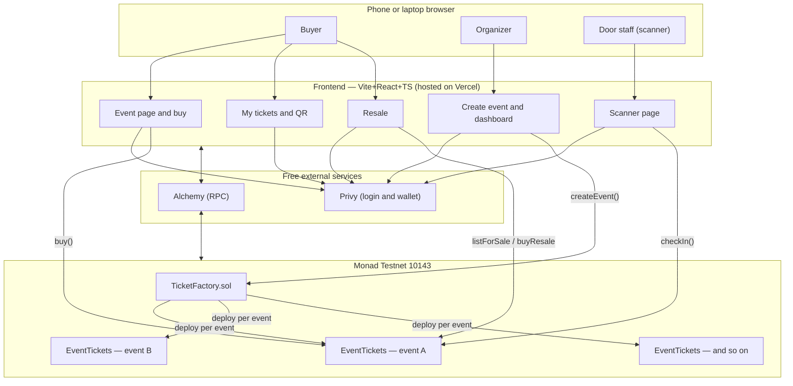
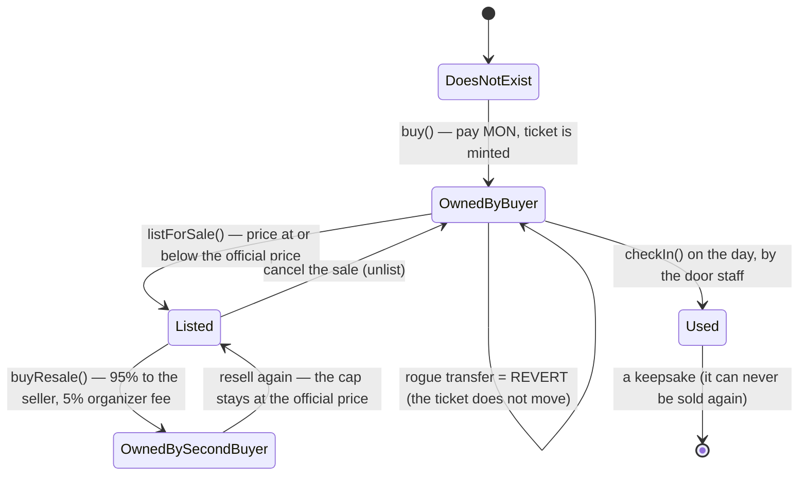
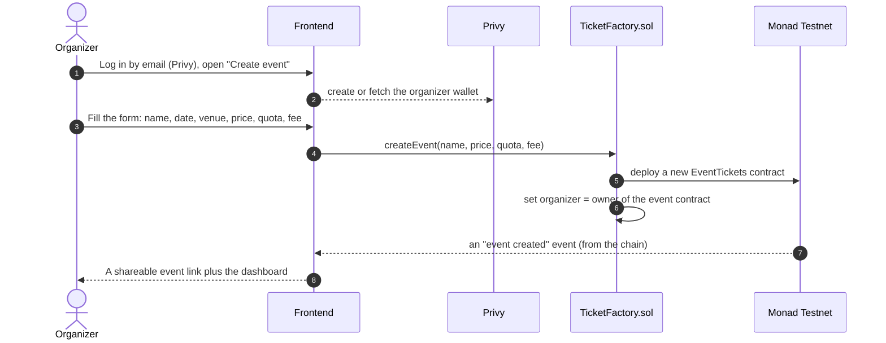
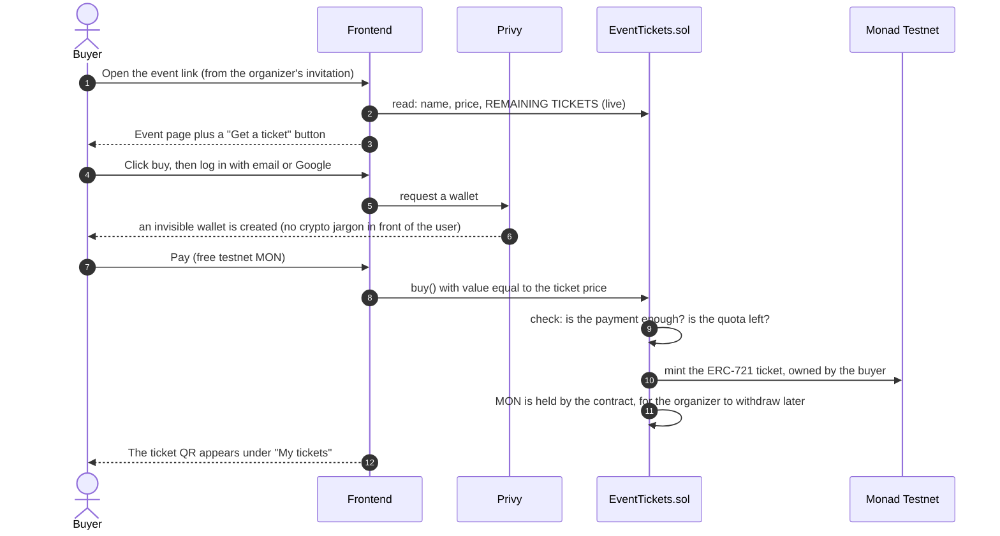
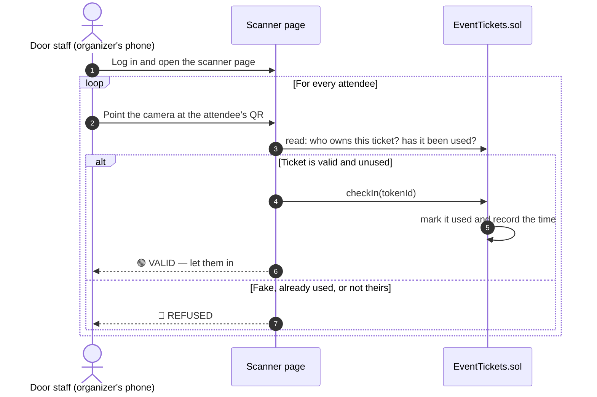
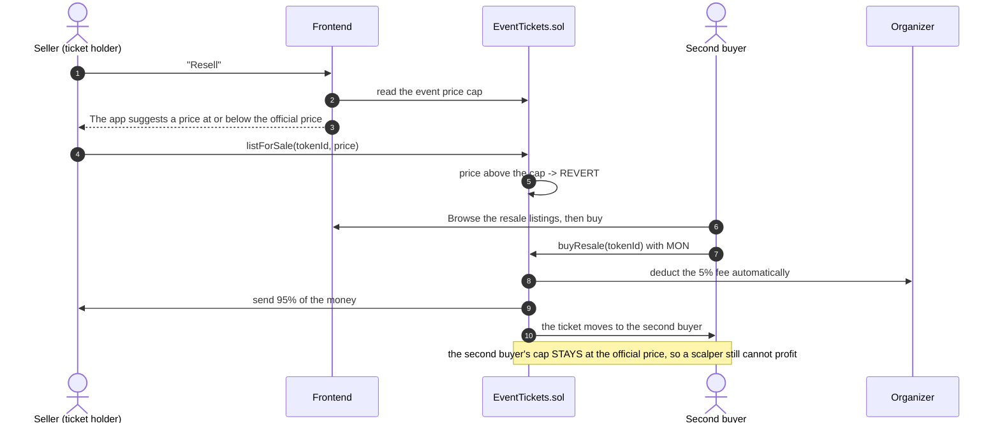
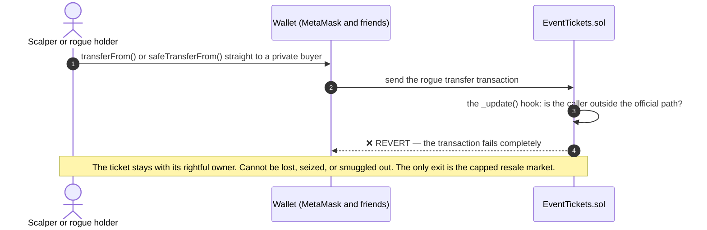

# 🎟️ Sticket — Full Project Blueprint

> **The ticket that sticks to its owner** — anti-scalping, anti-dead-ticket event ticketing for community events, on-chain on Monad.
> **Hackathon:** Monad Metropolis · **Track 02 — Consumer Products & Payments** ($30,000 / top 3 teams)
> **Build window:** 1 Sep – 13 Oct 2026 · **Submission target:** 12 Oct (1 day buffer) · Winners: 3 Nov
> **Official source:** <https://monad.xyz/developers/hackathons/metropolis>

---

## Table of contents

1. [Identity and idea](#1-identity-and-idea)
2. [Simple architecture](#2-simple-architecture)
3. [User workflow](#3-user-workflow)
4. [The 30-second overview: what is this system?](#4-the-30-second-overview-what-is-this-system)
5. [Full tech stack (everything at zero cost)](#5-full-tech-stack-everything-at-zero-cost)
6. [Overall architecture](#6-overall-architecture)
7. [The life of a ticket (the core anti-scalping logic)](#7-the-life-of-a-ticket-the-core-anti-scalping-logic)
8. [How the system works: sequence diagrams](#8-how-the-system-works-sequence-diagrams)
9. [Development workflow: four phases (10 Sep to 12 Oct)](#9-development-workflow-four-phases-10-sep-to-12-oct)
10. [Full directory tree (F0 to production/submission)](#10-full-directory-tree-f0-to-productionsubmission)
11. [Metropolis sponsors and bounties](#11-metropolis-sponsors-and-bounties)
12. [Official submission requirements](#12-official-submission-requirements)
13. [Mini glossary](#13-mini-glossary)

---

## 1. Identity and idea

### Track 02 — Consumer Products & Payments

**Idea 2: "The ticket that sticks to its owner" — anti-dead-ticket ticketing for community events**

**Concept:** a digital ticket whose ownership is recorded on-chain, so if the event moves to another platform or you move to another community, your ticket stays alive. Resale rules can be set automatically (for example: resale price capped at the purchase price, so scalpers cannot profit) — this is the track's official idea number 2.

- **The MVP:** a simple NFT contract (the ticket) plus a buy/claim page and a QR check-in
- **The real Indonesian sector:** campus events, workshops, study circles, community meetups — everyone who suffers from dead tickets
- **Solo difficulty:** 3/5 (the NFT part is easy, the check-in system adds work)
- **What sells it to judges:** programmable resale rules are something Tiket or Loket cannot offer — on-chain native

---

## 2. Simple architecture

```
TicketFactory.sol  <- the organizer creates an event from the UI (one contract deployed per event)
    └─ EventTickets.sol (ERC-721 on Monad testnet 10143)
         ├─ buy()        : pay -> ticket + QR
         ├─ resale()     : price LOCKED at or below the purchase price + 5% organizer fee (on-chain)
         ├─ _update()    : any transfer outside the official path = REVERT <- the anti-scalping core
         └─ checkIn()    : one scan per ticket, recorded on-chain

React app (no backend, no database: everything comes from the chain)
```

---

## 3. User workflow

### 👤 Buyer

> Open the event link -> see the live remaining count -> "Get a ticket" -> log in by email (a wallet is created automatically, and the word "blockchain" never appears in the UI) -> pay -> QR appears under "My tickets" -> on the day, show the QR -> staff scan it -> entry. Cannot attend? Resell it, with the price automatically capped at the purchase price, so a scalper cannot profit.

### 🎪 Organizer

> "Create event" form -> share the link -> real-time sales dashboard -> on the day, open the scanner page on a phone -> green or red -> resale fees arrive automatically.

---

## 4. The 30-second overview: what is this system?

Sticket is a web app for selling event tickets, but its **official record book is the Monad blockchain**, not a server. Three consequences matter:

1. **No backend and no database.** A server is where trust is kept (and where it can cheat or shut down). Here every record — who owns a ticket, which tickets have been used, what the maximum resale price is — lives in a smart contract. The frontend only reads and writes to the chain.
2. **A ticket is an NFT (ERC-721).** Like a digital land certificate: a unique number, a rightful owner, and transfers that are only valid when they follow the official procedure.
3. **The anti-scalping rules are welded into the contract, not the UI.** A UI can be bypassed; a contract cannot be forced by anyone. That is the heart of the pitch.

---

## 5. Full tech stack (everything at zero cost)

| Layer | Tool | Job | Cost |
|---|---|---|---|
| Blockchain | **Monad Testnet** (chain 10143) | The "server" holding all data and funds | Free (MON faucet) |
| Contracts | **Solidity** + **OpenZeppelin** (ERC-721) | Contract language plus security-reviewed components | Free |
| Contract toolkit | **Foundry** (`forge`, `cast`, `anvil`) | Write tests, deploy, debug contracts | Free |
| Login and wallet | **Privy** | Users log in with email or Google and a wallet is created behind the scenes | Free up to roughly 1,000 users per month |
| Frontend | **Vite + React + TypeScript** | The buyer and organizer web app | Free |
| Chain client | **wagmi + viem** | React to contract bridge (read data, send transactions) | Free |
| Buyer QR | **qrcode.react** | Render the QR from the ticket data | Free |
| QR scanner | **html5-qrcode** | The organizer's phone camera reading the QR | Free |
| RPC | **Alchemy** (sponsor) | A faster road between the frontend and Monad than the public RPC | Free, 30 million compute units per month |
| Hosting | **Vercel** | Puts the app online behind a link | Free |
| Versioning | **Git + GitHub** | Code history and evidence for the judges | Free |

---

## 6. Overall architecture



**Why is there a factory?** So that every event has its own isolated ticket contract (a bug in event A cannot touch event B), and so the organizer fully owns their event's contract. The factory is a mould that stamps out a new contract per event.

---

## 7. The life of a ticket (the core anti-scalping logic)



**The most important point:** the price cap does not drop for the second buyer. The cap is the event's official price, permanently. A scalper buys and can resell for at most the official price, so **profit is impossible** no matter how many hands the ticket passes through. And `Used` (already checked in) is a dead end: it can never be sold again.

---

## 8. How the system works: sequence diagrams

### 8.1 The organizer creates an event



### 8.2 A buyer buys a ticket (the "first five minutes" path)



### 8.3 The day itself: check-in with the scanner



> **Design note:** validity is checked **against the chain**, not from the QR alone, so a photographed or forwarded QR is still refused when the on-chain owner does not match.

### 8.4 Resale (the differentiating feature)



### 8.5 A scalper's attempt: transferring outside the official path (where scalping dies)



> This is the system's one and only key: ERC-721 has a critical point called `_update()` that every ticket movement must pass through. We override that point: **if the movement does not come from `buy`, `buyResale` or `mint`, reject it.**
> An honest side effect for the write-up: sending a ticket to a friend for free is blocked too. It could be opened up with an `allowGift` flag per event, off by default.

---

## 9. Development workflow: four phases (10 Sep to 12 Oct)

```mermaid
flowchart TB
    K(("START<br/>empty")) --> F0
    F0["F0 · Foundation (10–12 Sep)<br/>install Foundry, set up the repo,<br/>deploy a dummy contract to testnet"] --> G0{"Does the RPC work?<br/>Is it visible in the explorer?"}
    G0 -- no --> F0
    G0 -- yes --> F1
    F1["F1 · Core contracts (12–16 Sep)<br/>TicketFactory + EventTickets:<br/>buy, resale cap, anti-transfer, checkIn, fee"] --> G1{"forge test<br/>all green?<br/>contract verified?"}
    G1 -- no --> F1
    G1 -- yes --> F2
    F2["F2 · Buyer frontend (17–23 Sep)<br/>Privy login, event page,<br/>buy -> QR, resale"] --> G2{"Does buy -> QR -> resale<br/>work in the browser?"}
    G2 -- no --> F2
    G2 -- yes --> F3
    F3["F3 · Organizer frontend (24–30 Sep)<br/>create event, live dashboard,<br/>phone camera scanner page"] --> G3{"Two phones, scanner<br/>working live?"}
    G3 -- no --> F3
    G3 -- yes --> F4
    F4["F4 · Evidence and submission (1–12 Oct)<br/>end-to-end test on two real phones, record the demo,<br/>write-up, deploy to Vercel, public repo"] --> G4{"Are all submission<br/>requirements complete?"}
    G4 -- no --> F4
    G4 -- yes --> SUB["🚀 SUBMIT — target 12 Oct<br/>(official deadline 13 Oct)"]
```



**The rule at every gate:** no phase starts until the current one is PROVEN to work (tests pass, the deploy is real, it is tested on real phones) rather than "looks fine". If you get stuck, stop and re-plan; do not force it.

**For this hackathon, "production" means:** an app deployed on Vercel (a public link anyone can open) plus a live contract on Monad testnet plus a demo video plus a write-up plus the repo. That is the finished result being judged. (Mainnet and real-money payments are a post-hackathon version 2 story, deliberately untouched for safety and time.)

---

## 10. Full directory tree (F0 to production/submission)

```text
sticket/                               <- Git repo root
├── README.md                         (F0->F4) the repo's face for judges: tagline, architecture, quickstart, demo link
├── LICENSE                            (F0) MIT
├── .gitignore                         (F0) node_modules, out, cache, broadcast, .env, dist
│
├── docs/
│   ├── blueprint.md                  <- this file (the project master document)
│   ├── architecture.md                (F0) every mermaid diagram
│   ├── runbook.md                     (F4) how a judge runs everything without asking
│   └── submission/
│       ├── writeup.md                 (F4) the official write-up (problem, solution, anti-scalping, limitations)
│       ├── demo-script.md             (F4) storyboard for a video of three minutes or less
│       └── screenshots/               (F4) visual evidence (buy, QR, resale, scanner, explorer)
│
├── tasks/
│   ├── plan.md · todo.md · lessons.md
│   ├── structure.md                   the official reference for the repo structure
│   └── review.md                      (F4) the post-submission review section
│
├── contracts/                         <- the Foundry project (run forge commands here)
│   ├── foundry.toml                   (F0) compiler configuration plus a testnet profile
│   ├── .env.example  /  .env 🔒       (F0) Alchemy RPC plus the deployer key [gitignored]
│   ├── src/
│   │   ├── EventTickets.sol          (F1) ERC-721: buy, resale cap and fee, anti-scalping _update, checkIn
│   │   └── TicketFactory.sol         (F1) createEvent() -> one contract per event plus a registry
│   ├── test/
│   │   ├── EventTickets.t.sol        (F1) seven scenarios: buy, quota, cap, rogue transfer reverts, and so on
│   │   └── TicketFactory.t.sol       (F1) deploys the child contract plus access control
│   ├── script/
│   │   └── Deploy.s.sol              (F0 dummy, then final in F1)
│   └── lib/ · out/ · cache/ · broadcast/   [generated] Foundry output, not committed
│
└── app/                               <- Vite + React + TS (deployed to Vercel)
    ├── package.json · vite.config.ts · tsconfig.json · index.html   (F0)
    ├── .env.example  /  .env 🔒       (F2) VITE_PRIVY_APP_ID, VITE_ALCHEMY_RPC_URL, VITE_FACTORY_ADDRESS [gitignored]
    ├── public/
    │   └── logo.svg · favicon.svg     (F0)
    └── src/
        ├── main.tsx                   (F0) Privy, wagmi and the router
        ├── App.tsx                    (F0) route table
        ├── lib/
        │   ├── chain.ts               (F0) Monad testnet 10143 plus the Alchemy transport
        │   ├── contracts.ts           (F1) contract address plus ABI binding
        │   └── abis/                  (F1) [auto] ABI generated from forge, never edited by hand
        ├── components/                (F2/F3) Button, TicketCard, QRTicket, EventHeader,
        │                                     StatPill, ScanResult
        ├── hooks/                     (F2/F3) useEvent, useBuyTicket, useMyTickets,
        │                                     useResale, useCreateEvent, useDashboard, useCheckIn
        └── pages/                     seven main screens:
            ├── EventPage.tsx          (F2) the event page plus buying
            ├── MyTicketsPage.tsx      (F2) "My tickets" plus QR
            ├── ResalePage.tsx          (F2) the resale market
            ├── CreateEventPage.tsx     (F3) the organizer form
            ├── DashboardPage.tsx       (F3) real-time sales
            └── ScannerPage.tsx         (F3) phone camera plus checkIn
```

### Principles behind this structure

- **Two separate worlds** — `contracts/` (Foundry and Solidity) and `app/` (React) — each with its own toolchain, never mixed. Their only bridge is the `abis/` folder (copied automatically from the Foundry build and never edited by hand) plus `contracts.ts` (the deployed contract address)
- **`tasks/` stays at the root** — matching the workflow (plan, todo, lessons plus structure.md)
- **The phase markers (F0 to F4)** record when each file is born — the structure grows in stages rather than being created all at once, so every phase has a repo that runs
- **Deliberately absent:** a backend, a database, a mainnet folder, and `*.mp4` video files in the repo (the video is hosted elsewhere and linked from the write-up)
- **Scope-creep control:** no extra pages and nothing beyond these seven pages and seven hooks without updating the plan first

> When you eventually run `git init`, `forge init contracts` and the Vite scaffold, the folder skeleton appears automatically from the tools. The files marked **(F0)** are the ones to fill in or change; the rest grow in later phases according to their markers.

---

## 11. Metropolis sponsors and bounties

### 🎯 The full sponsor map (17 bounties, 11 sponsors)

| Sponsor | Bounty | Product | Free tier? |
|---|---|---|---|
| **Privy** | $5,000 | Email or Google login plus an invisible wallet | ✅ Free up to about 1,000 monthly active users, roughly 50,000 signatures per month |
| **Alchemy** | $1,000 in credit | RPC and blockchain infrastructure | ✅ 30 million compute units per month, 25 requests per second |
| **Monad Foundation (Mera)** | 2 x $2,500 | A passkey library for a two-click on-chain account | ✅ The library is free |
| **Dynamic** | $5,000 | Login plus wallet (a Privy competitor) | ✅ Up to 1,000 monthly active users |
| **Agora** | 2 x $10,000 | Stablecoin payments | A developer tier exists, but integration is required |
| **Kimi (Moonshot)** | $3,000 in credit | AI models | ❌ No free API tier (minimum top-up of $1) |
| **Alibaba Cloud** | $5,000 in credit | AI models (Qwen 3.8 Max) | ❌ Credit must be paid for |
| **Kepler (Tencent)** | $2,000 in credit | AI models (Hunyuan) | ❌ Credit must be paid for |
| **Chainlink** | $3,000 | CRE (multi-chain runtime) | Only for oracle or CCIP needs, which is overkill here |
| **Nansen AI** | $5,000 | On-chain analytics | ❌ Not for an MVP |
| **Perpl** | 2 bounties ($5k + $3k) | Perpetuals API plus analytics | ❌ Not our domain |
| **Metamask** | $2,500 | An agent wallet plugin | ❌ Not our domain |
| **Aurora Intents** | $5,000 | Cross-chain liquidity | ❌ Not our domain |

### ✅ What we actually use (per the rule: free wherever possible)

**1. Privy — core to the stack, exactly as planned. ($5,000 bounty)**
The free tier covers about 1,000 monthly active users and roughly 50,000 signatures, far more than a demo and testing need. It was the login choice from the start, and it is now confirmed: using Privy automatically enters us for the largest infrastructure bounty in the consumer category. It is the only sponsor whose product is **already in our architecture**, so entering costs no extra work.

**2. Alchemy — replacing the public RPC. ($1,000 credit bounty)**
The frontend needs an RPC to read the contract (remaining tickets, ownership, check-in status). Monad's public RPC is not stable enough for a demo. Alchemy's free tier gives 30 million compute units a month, roughly 1.8 million simple requests, which is more than enough, free, and "Best Projects using Alchemy" is the cheapest bounty to win.
⚠️ To check after signing up: whether Monad testnet 10143 is already active in the Alchemy dashboard. If not, one email to support should settle it; they are an official sponsor, so it very likely already is.

**3. Mera (Monad Foundation) — a smart optional, not a requirement. (2 x $2,500 bounty)**
Monad's free official library creates an account with a phone passkey in two clicks and no seed phrase. Two paths: **(a)** stick with Privy alone, which is safe, worth a larger bounty, and already planned; **(b)** if F2 and F3 finish early, add Mera as an *alternative login route* ("Sign in with a passkey"), which targets two Monad Foundation bounties at once and strengthens the invisible-UX story in front of Monad's judges. **Decide in F3, not now** — two authentication systems must not become a burden for a solo developer.

### 🟡 OPTIONAL (a bonus if time remains, never at the core's expense)

**4. A small AI feature via Kimi ($3,000) or Qwen through Alibaba ($5,000)** — both are credit, not a free tier. The one sensible use case for Sticket: the organizer types an event title, and the AI generates a description and poster text. Small and charming, but it needs a paid API key. Only consider it if credit is left over, and **do not buy credit for this.** The "Best Community Team Project" bounty ($5,000) needs no special technology, only genuine community activity.

**5. Agora ($10,000)** — relevant only if Sticket ever adds cross-border stablecoin payments. For a testnet ticket MVP, skip it for now.

### ❌ What we skip (to stay focused)

Nansen, Perpl, Chainlink, Aurora, Metamask and Dynamic are either outside our domain or duplicates of choices already made. Using both Dynamic and Privy would raise an architecture red flag, so pick one.

### 💰 Total impact (realistically, from $0 to $0)

- **Infrastructure cost stays at $0:** Monad testnet is free (testnet gas), Privy is free, Alchemy is free, Vercel or Netlify hosting is free, and there is no backend or database because everything is on-chain
- **A realistic bounty board:** Privy ($5k) plus Alchemy ($1k) plus Mera ($5k if integrated) comes to **a potential $11,000 on top of the track prizes**, with close to zero extra work for the first two

> **An honest note:** the official page has a section, "Participant resources — tooling every team gets for free during the build", whose contents only become fully visible after joining the platform. Supporters listed there include Tenderly, QuickNode, Envio, Kimi and Cleanverse. After registering, judge which ones are worth using.

**Bottom line:** sign up, switch the RPC to Alchemy, continue the plan as it stands with Privy, and consider Mera in F3.

---

## 12. Official submission requirements (from the Metropolis page)

- **A product that can be used** (a working product, not a mockup)
- **A public project profile** on the platform
- **A short demo video** (target three minutes or less, recorded on two real phones)
- **A short write-up:** the features, why it is on-chain, the anti-scalping rules, and the MVP's limitations, written honestly, because judges value technical honesty
- **A code link** (a public repo; judges must be able to verify six weeks of work)
- Judging runs 14–27 Oct, and winners are announced on 3 Nov

---

## 13. Mini glossary

| Term | Meaning |
|---|---|
| **Wallet** | A "purse" holding a digital signing key; Privy creates one automatically from an email |
| **Transaction (tx)** | A request to write to the blockchain; it must be signed by a wallet and pay gas |
| **Gas** | The postage fee on a transaction; on testnet it is paid in free MON from the faucet |
| **Mint** | Creating a new NFT, which is how a ticket is born |
| **ERC-721** | The one-of-a-kind NFT standard, where every ticket is unique and numbered |
| **RPC** | The API gateway from the frontend to the blockchain; we use Alchemy |
| **Faucet** | A free tap for testnet tokens |
| **Explorer** | A site for inspecting the blockchain, where the deploy evidence is visible |
| **Escrow** | Funds or assets held by the contract until the organizer collects them, with no third party holding the money |

---

## 📎 Corrections and conversion notes

This document was converted from `desc.txt`, a raw summary of a chat. Small corrections were applied so that it matches the official documents under `tasks/`:

- A truncated URL, `metropoli`, was completed to `metropolis`
- `PRIVYAPP_ID` became `VITE_PRIVY_APP_ID`, `ALCHEMY_RPC` became `VITE_ALCHEMY_RPC_URL`, and `FACTORY_ADDRESS` became `VITE_FACTORY_ADDRESS`, following `tasks/structure.md`
- The guard hook is described as `_update()`, the real function name, and the anti-scalping wording replaces the earlier shorthand
- Project name: `NEPEL` was renamed to `Sticket` throughout, and the document was translated into English
- The mermaid block label `mermaid.js` became `mermaid`, so GitHub and VS Code render it
- All substance, figures and diagrams are preserved exactly as in the source

---

## 📌 Status as built

Where the shipped code differs from this plan, recorded so that neither a reader nor a judge is misled. The plan above describes the intent; the README describes what exists.

- **One contract, no factory.** `TicketFactory.sol` was not built. An event is one `EventTickets` contract deployed with `script/Deploy.s.sol`, so creating an event is a deploy rather than a form, and no create-event page exists.
- **Six pages, not seven.** Event, My tickets, Resale, Dashboard and Scanner exist, plus Terms, Privacy and Refunds. `CreateEventPage` has no contract to talk to.
- **App configuration.** The app reads `VITE_MONAD_RPC_URL`, `VITE_EVENT_ADDRESS`, `VITE_SCANNER_EVENT_ADDRESS` and optionally `VITE_PRIVY_APP_ID`. The planned `VITE_ALCHEMY_RPC_URL` and `VITE_FACTORY_ADDRESS` do not apply without the factory.
- **Scanner library.** `@zxing/browser` replaced `html5-qrcode`, because it is actively released and published with build provenance.
- **Privy is optional and lazily loaded.** Email login activates only when an App ID is present; otherwise the app uses any injected browser wallet and never downloads Privy's bundle. Privy offers no gas sponsorship on a custom chain, so an embedded wallet starts empty and must be funded.
- **Escrow changes what "owner" means.** While a ticket is listed, the contract owns it, so any interface showing a user's tickets must read the listing record rather than only `ownerOf`.
- **The cap bounds the price, not profit.** A buyer of a discounted listing can resell at the official price and come out ahead. The README states this precisely rather than claiming that profit is impossible.
- **No refunds.** The contract has no path that returns money to a buyer; capped resale is the only exit.
- **This file lives at the repository root**, not under `docs/` as the tree above suggests.
- **Not yet produced:** `docs/architecture.md`, `docs/runbook.md`, `docs/submission/*`, `tasks/structure.md`, `tasks/review.md`, the hosted deployment, and the demo video.
